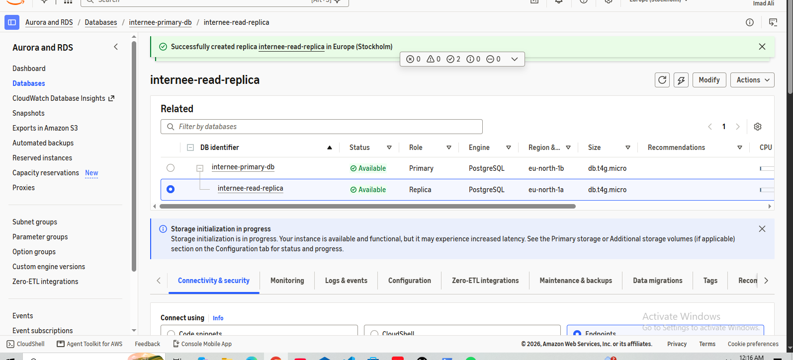
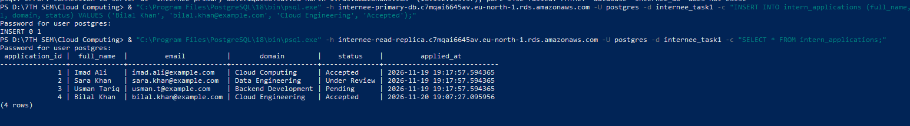
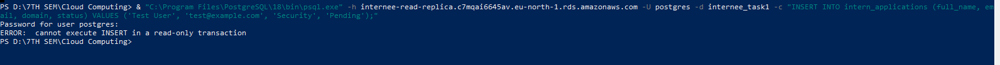

# AWS RDS PostgreSQL Migration and Read Replica


This project demonstrates how to migrate a local PostgreSQL database to Amazon RDS and add an asynchronous read replica for read scaling and workload isolation.

It was completed as part of the **Internee.pk Virtual Cloud Computing Internship**.

## Table of Contents

- [Architecture](#architecture)
- [Technologies Used](#technologies-used)
- [Prerequisites](#prerequisites)
- [Implementation](#implementation)
- [Verification](#verification)
- [Results](#results)
- [Key Learnings](#key-learnings)

## Architecture

```text
+----------------------+       pg_dump / psql        +----------------------+
|  Local PostgreSQL DB | --------------------------> |  Amazon RDS Primary  |
|     internee_db      |                             |  internee-primary-db |
+----------------------+                             +----------+-----------+
                                                                  |
                                                                  | Asynchronous
                                                                  | replication
                                                                  v
                                                       +----------------------+
                                                       |   Amazon RDS Replica |
                                                       | internee-read-replica|
                                                       |     Read-only        |
                                                       +----------------------+
```

| Component | Description |
| --- | --- |
| **Local database** | PostgreSQL database named `internee_db` |
| **Primary instance** | Handles transactional writes and normal reads |
| **Read replica** | Offloads read-only queries and is asynchronously synchronized with the primary |
| **Security group** | Restricts PostgreSQL access to the required source on TCP port `5432` |

## Technologies Used

- Amazon Web Services
- Amazon RDS for PostgreSQL
- PostgreSQL 17
- `pg_dump`
- `psql`
- AWS RDS Security Groups

## Prerequisites

- AWS account with access to Amazon RDS
- PostgreSQL installed locally
- Database credentials and network access
- PostgreSQL tools available in `C:\Program Files\PostgreSQL\17\bin`

## Implementation

### 1. Export the Local Database

Create a plain SQL backup of the local `internee_db` database:

```powershell
& "C:\Program Files\PostgreSQL\17\bin\pg_dump.exe" `
  -U postgres `
  -d internee_db `
  -F p `
  -f internee_backup.sql
```

### 2. Create the RDS Primary Instance

1. Open the **Amazon RDS** console.
2. Choose **Create database**.
3. Select **PostgreSQL**.
4. Choose the **Free tier** template.
5. Set the DB instance identifier to `internee-primary-db`.
6. Configure the master username and password.
7. Enable public access only if remote access is required.
8. Attach a security group that allows inbound PostgreSQL traffic on TCP port `5432`.
9. Set the initial database name to `internee_db`.

### 3. Restore the Database to RDS

Replace the endpoint below with the endpoint shown in the RDS console:

```powershell
& "C:\Program Files\PostgreSQL\17\bin\psql.exe" `
  -h database Endpoint URL `
  -U postgres `
  -d internee_db `
  -f internee_backup.sql
```

Confirm that the migrated data is available:

```powershell
& "C:\Program Files\PostgreSQL\17\bin\psql.exe" `
  -h database Endpoint URL `
  -U postgres `
  -d internee_db `
  -c "SELECT * FROM intern_applications;"
```

### 4. Create the Read Replica

1. Open `internee-primary-db` in the RDS console.
2. Choose **Actions** > **Create read replica**.
3. Set the replica identifier to `internee-read-replica`.
4. Match the required instance settings and public accessibility configuration.
5. Attach the appropriate security group.



## Verification

### 1. Insert a Record into the Primary

Execute the write operation against the primary endpoint:

```powershell
& "C:\Program Files\PostgreSQL\17\bin\psql.exe" `
  -h database Endpoint URL `
  -U postgres `
  -d internee_db `
  -c "INSERT INTO intern_applications (full_name, email, domain, status) VALUES ('Bilal Khan', 'bilal.khan@example.com', 'Cloud Engineering', 'Accepted');"
```

### 2. Verify Replication on the Read Replica

Query the replica endpoint and confirm that the primary's new record is visible:

```powershell
& "C:\Program Files\PostgreSQL\17\bin\psql.exe" `
  -h database Endpoint URL `
  -U postgres `
  -d internee_db `
  -c "SELECT * FROM intern_applications;"
```



### 3. Test Read-Only Isolation

Attempt to insert a record directly into the read replica:

```powershell
& "C:\Program Files\PostgreSQL\17\bin\psql.exe" `
  -h internee-read-replica.c7mqai6645av.eu-north-1.rds.amazonaws.com `
  -U postgres `
  -d internee_db `
  -c "INSERT INTO intern_applications (full_name, email, domain, status) VALUES ('Test User', 'test@example.com', 'Security', 'Pending');"
```

The replica rejects the write and returns:

```text
ERROR: cannot execute INSERT in a read-only transaction
```



## Results

- The local database was successfully exported and restored in Amazon RDS.
- The primary instance accepted write operations.
- The read replica received changes asynchronously from the primary.
- Read queries executed successfully against the replica endpoint.
- Direct write operations against the replica were rejected.

## Key Learnings

- Amazon RDS can separate read-heavy workloads from the primary database.
- Read replicas use asynchronous replication.
- Replica endpoints provide read-only access and cannot be used for application writes.
- Security groups and public accessibility must be configured carefully.
- Database migration can be performed with PostgreSQL-native tools such as `pg_dump` and `psql`.
